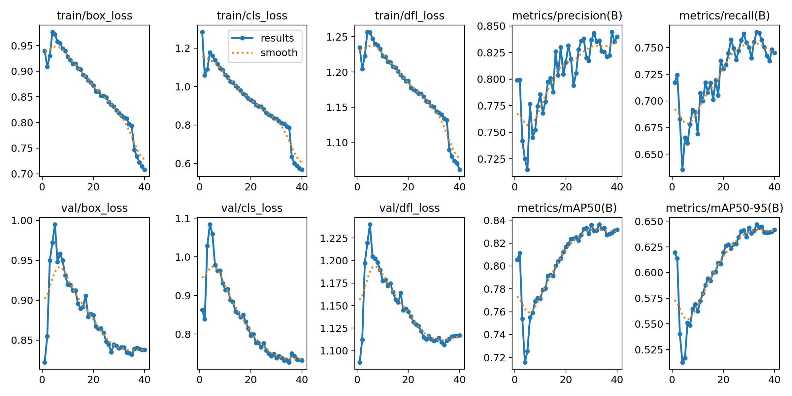

# YOLO11n ile Pascal VOC Nesne Tespiti

Derin Öğrenme dersi Bilgisayarlı Görü ödevi: COCO ile ön-eğitimli **YOLO11n** modeli, **Pascal VOC** (20 sınıf) veri setinde ince ayar (fine-tuning) ile eğitildi, test kümesinde değerlendirildi ve **Gradio** ile çalışan bir web uygulamasına dönüştürüldü.

## Proje Özeti

| Alan | Bilgi |
|---|---|
| Görev | Nesne tespiti (Object Detection) |
| Veri seti | Pascal VOC 2007 + 2012 — 20 sınıf ([resmî site](http://host.robots.ox.ac.uk/pascal/VOC/)) |
| Model | Ultralytics YOLO11n (2,59 M parametre, 6,5 GFLOPs), COCO ön-eğitimli → VOC fine-tune |
| Giriş boyutu | 640 × 640 |
| Eğitim ortamı | Google Colab Pro, NVIDIA L4 GPU (24 GB) |
| Uygulama | Gradio (yerel, CPU) |
| Repository | https://github.com/FurkanBSRR/yolo-voc-object-detection |

## Veri Seti Ayrımı

| Küme | Kaynak | Görüntü | Nesne* |
|---|---|---|---|
| Train | VOC2007 trainval + VOC2012 trainval (%90, seed=42) | 14 896 | 36 080 |
| Validation | Aynı havuzun %10'u | 1 655 | 3 978 |
| Test | VOC2007 resmî test kümesi | 4 952 | 12 032 |

\* `difficult` olarak işaretli nesneler VOC standardına uygun olarak hariç tutuldu.

## Eğitim Ayarları

| Ayar | Değer |
|---|---|
| Epoch | 40 (en iyi epoch: 33) |
| Batch size | 32 |
| Optimizer | SGD (momentum 0.937, weight decay 5e-4) |
| Learning rate | lr0 = 0.002, lineer azalma (lrf = 0.01), 3 epoch warmup |
| Aktivasyon | SiLU (gizli katmanlar) |
| Çıkış | Sigmoid (sınıf skorları), DFL (kutu dağılımı); anchor-free decoupled head + NMS |
| Loss | 7.5 · CIoU (box) + 0.5 · BCE (cls) + 1.5 · DFL |
| Veri artırma | Mosaic (son 5 epoch kapalı), yatay çevirme, HSV, ölçekleme |
| Karma hassasiyet | AMP (FP16) |

Hiperparametre denemeleri (validation mAP@50-95):

| Deney | Değişiklik | Sonuç |
|---|---|---|
| v1 | lr0 = 0.01, patience = 10 | 0.475 (11. epoch'ta erken durdu) |
| v2 | lr0 = 0.002, patience = 15 | 0.619 (16. epoch'ta erken durdu) |
| **v3** | lr0 = 0.002, erken durdurma kapalı | **0.647** (40 epoch) |

## Sonuçlar (Test Kümesi — 4 952 görüntü)

| Metrik | Değer |
|---|---|
| **mAP@50** | **0.8507** |
| **mAP@50-95** | **0.6501** |
| Precision | 0.8129 |
| Recall | 0.7813 |
| F1-score | 0.7968 |
| Mean IoU (doğru tespitler, conf ≥ 0.25) | 0.8674 |
| Toplam eğitim süresi | 47,0 dk (NVIDIA L4) |
| Inference süresi (tek görüntü, 640) | GPU L4: 14,15 ms · CPU (Colab): 39,35 ms · Yerel dizüstü CPU: ort. 80,0 ms |

En iyi sınıflar (AP@50-95): bus 0.794, car 0.756, horse 0.741 · En zayıf: pottedplant 0.358, chair 0.484, boat 0.503



## Telefon Fotoğrafları ile Test

| # | Sahne | Tespitler | TP | FP | Süre (ms) |
|---|---|---|---|---|---|
| 1 | Kedi (akşam, düşük ışık) | cat 0.87 | 1 | 0 | 84.9 |
| 2 | Boğaz'da tekne | boat 0.76 | 1 | 0 | 71.9 |
| 3 | Kafede iki laptop | chair ×2, tvmonitor 0.40 (laptop) | 2 | 1 | 72.8 |
| 4 | Galerideki arabalar | car ×6 | 5 | 1 | 89.7 |
| 5 | Kalabalık sokak | person ×8 | 8 | 0 | 80.5 |

Başlıca hata kaynakları: küçük/uzak nesneler (640 px'e küçültme), kadraj kenarında kesik ve iç içe nesnelerde çift kutu, sınıf dışı nesneler (laptop → tvmonitor). Sonuç görselleri: [`test_outputs/`](test_outputs/)

## Proje Yapısı

```
yolo-voc-object-detection/
├── app.py                  # Gradio uygulaması
├── requirements.txt
├── weights/best.pt         # Eğitilmiş model (epoch 33)
├── notebooks/
│   └── 01_train_colab.ipynb   # Veri hazırlığı, eğitim, değerlendirme (Colab)
├── results/                # Eğitim/test grafikleri, metrikler (summary.json)
├── test_images/            # Telefonla çekilen 5 fotoğraf
└── test_outputs/           # Uygulama çıktıları + detections_log.csv
```

## Kurulum ve Çalıştırma

Python 3.10+ gerekir (3.12 ile test edildi).

```bash
git clone https://github.com/FurkanBSRR/yolo-voc-object-detection.git
cd yolo-voc-object-detection
python -m venv .venv
# Windows:
.venv\Scripts\activate
# macOS / Linux:
source .venv/bin/activate
pip install -r requirements.txt
python app.py
```

Tarayıcıda `http://127.0.0.1:7860` adresini açın, bir fotoğraf yükleyin ve **Tespit et**'e basın. Uygulama kutucukları, sınıf etiketlerini, güven skorlarını ve inference süresini gösterir.

## Modeli Yeniden Eğitmek

`notebooks/01_train_colab.ipynb` dosyasını Google Colab'da açın, GPU çalışma zamanı seçin ve hücreleri sırayla çalıştırın. Not defteri veri setini indirir, train/val/test olarak ayırır, modeli eğitir, tüm metrikleri hesaplar ve `best.pt` dosyasını indirir.

## Kaynaklar

- Ultralytics YOLO: https://docs.ultralytics.com
- Pascal VOC: Everingham et al., *The PASCAL Visual Object Classes (VOC) Challenge*, IJCV 2010
- Gradio: https://www.gradio.app
